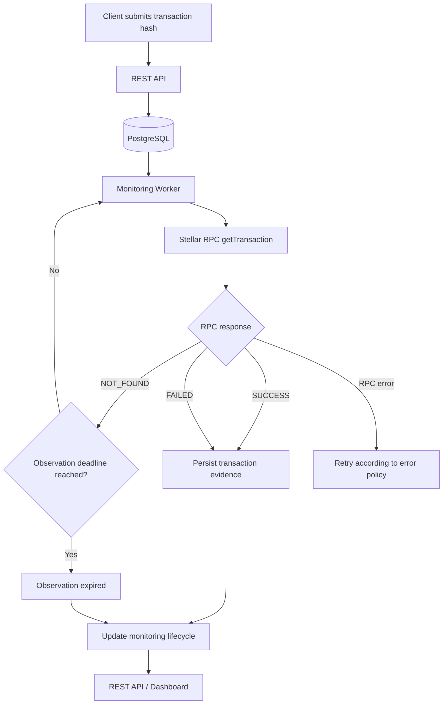

# StellarScope

**Transaction monitoring infrastructure for Stellar and Soroban applications.**

StellarScope is a backend service that monitors Stellar transaction hashes through the Stellar RPC interface, tracks their observed outcomes, and preserves transaction evidence for subsequent inspection.

It provides a persistent monitoring workflow backed by PostgreSQL, an independently running asynchronous worker, and a REST API. A React dashboard provides visibility into registered transactions and their monitoring status.

## The Problem

Applications interacting with Stellar need a reliable way to determine the outcome of submitted transactions.

A call to `getTransaction` may return `SUCCESS`, `FAILED`, or `NOT_FOUND`. A transaction that is not yet available through RPC cannot simply be treated as failed. Applications must account for delayed transaction availability, temporary RPC failures, and the need to retain transaction evidence.

Implementing this independently for multiple transactions introduces additional concerns:

- Coordinating concurrent monitoring workers.
- Recovering jobs after worker interruptions.
- Separating transaction outcomes from RPC availability.
- Managing polling intervals and observation deadlines.
- Preserving the original RPC response and transaction XDR.

StellarScope centralises these responsibilities in a persistent monitoring service.

## System Overview

A transaction moves through the following monitoring workflow:



The API accepts monitoring requests and exposes persisted transaction information. The worker independently claims eligible jobs, queries Stellar RPC, processes responses, and updates their state.

PostgreSQL serves as both the persistence layer and the coordination mechanism between workers.

## Core Capabilities

### Transaction monitoring
- Register transaction hashes for monitoring.
- Query transaction outcomes through Stellar RPC.
- Continue observation when RPC returns `NOT_FOUND`, subject to the configured observation policy.
- Stop monitoring when a terminal result is observed or the observation deadline is reached.

### Persistent job coordination
- Store monitoring jobs in PostgreSQL.
- Coordinate concurrent workers using `SELECT ... FOR UPDATE SKIP LOCKED`.
- Use worker leases to support job recovery after interruptions.
- Persist monitoring state independently of the API process lifecycle.

### Transaction evidence and decoding
- Preserve raw RPC responses in PostgreSQL JSONB.
- Retain available base64 XDR evidence.
- Decode available transaction result information.
- Handle fee-bump transactions by inspecting their inner transaction result.
- Treat decoding as best-effort while retaining the original evidence.

### Soroban contract discovery
- Register contracts for event discovery.
- Retrieve contract events using cursor-based pagination.
- Persist discovery checkpoints to support continued processing.

### RPC health monitoring
- Expose an endpoint for checking RPC availability.
- Distinguish infrastructure and RPC errors from transaction failures.

### Dashboard
- View registered transactions.
- Inspect monitoring statuses.
- Navigate paginated transaction records and filter by status.

## Architecture

StellarScope is structured as a modular backend application with an independently executable monitoring worker and a separate frontend.

| Component | Responsibility |
|---|---|
| FastAPI application | Transaction registration and retrieval, contract discovery, health endpoints |
| Monitoring worker | Job claiming, RPC polling, response processing, and lifecycle updates |
| PostgreSQL | Transaction records, monitoring state, job coordination, and preserved RPC evidence |
| Stellar RPC client | Communication with the Stellar/Soroban RPC interface |
| XDR decoder | Best-effort interpretation of transaction result evidence |
| React frontend | Monitoring visibility and transaction listing |

### Design considerations

**Database-backed coordination**

PostgreSQL is used to coordinate monitoring jobs without introducing a separate message broker for the current system. Row-level locking with `SKIP LOCKED` allows multiple workers to claim different eligible jobs without processing the same job concurrently.

**Worker and API separation**

The API handles incoming requests and reads. The worker performs ongoing monitoring independently. This prevents long-running polling responsibilities from being tied to the HTTP request lifecycle.

**Explicit transaction and monitoring states**

Stellar RPC status and StellarScope monitoring lifecycle represent different things.

| State category | Values | Meaning |
|---|---|---|
| RPC status | `SUCCESS`, `FAILED`, `NOT_FOUND` | Result returned by Stellar RPC |
| Monitoring lifecycle | `ACTIVE`, `COMPLETED`, `OBSERVATION_EXPIRED` | State of StellarScope's monitoring process |

`NOT_FOUND` is not a transaction failure or proof that a transaction never existed. It means the RPC endpoint did not return a transaction record at the time of the query.

Likewise, `OBSERVATION_EXPIRED` means StellarScope stopped monitoring after its observation window. It does not represent an on-chain transaction expiry.

RPC errors are handled separately from transaction outcomes.

For more detailed architectural rationale, see [DECISIONS.md](DECISIONS.md).

## Technology Stack

| Area | Technologies |
|---|---|
| Backend | Python, FastAPI |
| Database | PostgreSQL, SQLAlchemy 2.x, asyncpg |
| Migrations | Alembic |
| Stellar integration | stellar-sdk, Stellar/Soroban RPC |
| HTTP client | HTTPX |
| Frontend | React, TypeScript, Vite, Axios |
| Testing | pytest, pytest-asyncio |
| Infrastructure | Docker, Docker Compose |
| CI | GitHub Actions |

## Getting Started

### Prerequisites

- Docker
- Docker Compose

### Run with Docker Compose

Clone the repository:

```bash
git clone git@github.com:fathiaoyinloyle/stellarscope.git
cd stellarscope
```

Configure environment variables using the provided `configs/.env.example` template and review the required database and Stellar RPC settings.

Start the services:

```bash
docker compose up --build -d
```

Apply database migrations:

```bash
docker compose exec app alembic upgrade head
```

Check the running services:

```bash
docker compose ps
```

### Application endpoints

| Service | URL |
|---|---|
| REST API | http://localhost:8000 |
| Swagger UI | http://localhost:8000/docs |
| ReDoc | http://localhost:8000/redoc |
| Frontend | http://localhost:5173 |
| API health | http://localhost:8000/health |

## API

The API exposes endpoints for transaction monitoring, contract discovery, and RPC health.

| Method | Endpoint | Description |
|---|---|---|
| `POST` | `/api/v1/transactions/register` | Register a transaction for monitoring |
| `GET` | `/api/v1/transactions/{hash}` | Retrieve a transaction's monitoring information |
| `GET` | `/api/v1/transactions/` | List monitored transactions |
| `POST` | `/api/v1/contracts/discovery/register` | Register a contract for event discovery |
| `GET` | `/api/v1/contracts/discovery/{address}` | Retrieve contract discovery information |
| `GET` | `/api/v1/rpc/health` | Check Stellar RPC health |
| `GET` | `/health` | Check API health |

The interactive API specification is available at `/docs` when the application is running.

## Configuration

Application configuration is supplied through environment variables. Use `configs/.env.example` as the reference for the variables supported by the application.

The Stellar RPC endpoint is configured through `SOROBAN_RPC_URL`. Configure the database connection using `DATABASE_URL`.

Do not commit actual credentials, private keys, or environment-specific secrets.

## Testing and Verification

Run the backend test suite:

```bash
cd backend
PYTHONPATH=src python -m pytest tests/ -v
```

Build the frontend:

```bash
cd frontend
npm install
npm run build
```

The backend test suite includes 37 tests across multiple test modules. The test suite verifies database model persistence, RPC client functionality, XDR decoding, API validation, and workflow integration.

**Current test results:** 27 tests pass, with 14 errors and failures documented in Known Issues below.

Run the test suite with: `cd backend && PYTHONPATH=src python -m pytest tests/ -v`

The frontend build has been verified with `npm run build`.

## Scope and Limitations

- The current project has been developed and verified primarily against Stellar Testnet.
- Mainnet operation has not been independently verified.
- Monitoring stops when the configured observation deadline is reached, even if no terminal RPC result has been observed.
- XDR decoding is best-effort; preserved raw RPC evidence remains the reference for subsequent inspection.
- The dashboard provides monitoring visibility and is not intended to replace a full Stellar development or transaction-management interface.
- **Known issues:** 5 test fixture interference issues (`test_lease_expiry_recovery`, `test_model_creation_and_persistence`, `test_workflow_integration.*`) have pre-existing DB session isolation issues with shared PostgreSQL test fixture. All 9 model tests pass in isolation. 3 workflow integration tests fail due to mock setup issues. RPC integration tests (22/22) and API validation tests (4/4) pass consistently.

## Project Documentation

- [DECISIONS.md](DECISIONS.md) — Architectural decisions and their rationale.
- [PROJECT_STATUS.md](PROJECT_STATUS.md) — Current implementation status.
- [CI workflow](.github/workflows/ci.yml) — Automated build and test configuration.

## License

See the repository for licensing information.
